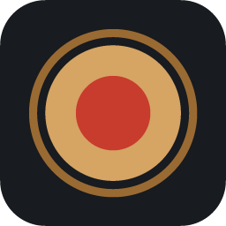

<p align="center"></p>

<h1 align="center">Deadlock Highlights</h1>

<p align="center">Acha os multi-kills de um replay do <b>Deadlock</b> e grava cada lance no <b>OBS</b>, com a câmera em quem matou.</p>

<p align="center"><a href="../../releases"><b>⬇ Baixar o instalador</b></a> · <a href="#tutorial">Tutorial</a> · <a href="#problemas-comuns">Problemas comuns</a></p>

> [!WARNING]
> **Projeto em desenvolvimento (work in progress).** Esta é uma versão inicial: a busca de destaques já funciona, mas a gravação automática ainda está sendo testada e pode falhar ou mudar. Se encontrar um problema, abra uma [issue](../../issues).

---

## O que faz

1. Você baixa o replay de uma partida no Deadlock (arquivo `.dem`).
2. O app lê todos os abates e lista cada vez que um jogador fez **2 ou mais abates em até 20 segundos** (dá para mudar).
3. Para cada lance escolhido, o app volta o replay alguns segundos antes, trava a câmera no jogador, liga a gravação do OBS e desliga logo depois do último abate.

Cada clipe sai com um nome que diz o que é, por exemplo `144195658_03_16-17_jogador_2kills.mp4`: partida, número do lance, tempo, jogador e abates.

O app não usa mods e não mexe nos arquivos do jogo; ele só cria um arquivo de comandos (`cfg/dlh_cmd.cfg`).

## O que você precisa

- Windows 10 ou 11 (64 bits)
- Deadlock pela Steam
- [OBS Studio](https://obsproject.com/) 28 ou mais novo (o servidor WebSocket já vem nele)

Não precisa instalar Python: vem tudo no instalador.

## Tutorial

### 1. Instalar

1. Baixe `DeadlockHighlights-Setup-x.y.z.exe` em [Releases](../../releases).
2. Rode o instalador. Ele não pede senha de administrador.
3. Abra o **Deadlock Highlights** pelo atalho da Área de Trabalho ou do Menu Iniciar.

> Se aparecer "O Windows protegeu o computador", clique em **Mais informações → Executar assim mesmo**. O aviso aparece porque o instalador ainda não tem assinatura digital.

### 2. Preparar (uma vez só)

A aba **1. Preparar** mostra cinco itens. Cada um fica com ✔ quando está certo; clique em **Verificar tudo de novo** depois de arrumar algum.

| Item | O que fazer |
|---|---|
| **Pasta do Deadlock** | O app acha sozinho. Se não achar, clique em **Procurar…** e escolha `…\steamapps\common\Deadlock\game\citadel`. |
| **Deadlock aberto com -condebug** | Clique em **Abrir o Deadlock com -condebug**. Para ficar permanente: Steam → botão direito no Deadlock → Propriedades → Opções de inicialização → `-condebug`. |
| **Tecla de comando no jogo** | No jogo, abra o console (<kbd>F7</kbd>), cole o comando abaixo e aperte <kbd>Enter</kbd>. O jogo guarda essa tecla. |
| **OBS (WebSocket)** | No OBS: **Ferramentas → Configurações do servidor WebSocket**, marque **Ativar servidor WebSocket**, clique em **Mostrar informações de conexão** e copie endereço, porta e senha para o app. Depois clique em **Testar conexão**. |
| **Cena do OBS** | Clique em **Criar / conferir cena**. O app cria a cena *Deadlock Highlights* com uma Captura de jogo. Ele só troca para ela enquanto grava e depois volta para a sua. |

Comando da tecla:

```
bind F10 "exec dlh_cmd"
```

### 3. Gravar os destaques

1. **Baixe o replay** no Deadlock: Perfil → Histórico de partidas → escolha a partida → **Baixar replay**.
2. Na aba **2. Destaques e gravação**, clique em **Atualizar lista** e escolha a partida.
3. Clique em **Achar destaques**. Em alguns segundos aparece a lista com tempo, jogador, herói, abates e vítimas.
4. Clique em **Abrir este replay no jogo**. Se o jogo já estiver aberto, o app copia o comando `playdemo replays/<número>`: cole no console e aperte Enter. Espere carregar e **feche o console**.
5. Selecione as linhas (<kbd>Ctrl</kbd>/<kbd>Shift</kbd> ou **Selecionar todos**) e clique em **Gravar selecionados**. Não use o mouse nem o teclado enquanto grava. **Parar** interrompe depois do clipe atual.
6. Os clipes vão para a pasta de gravação do OBS (**Abrir pasta dos vídeos**).

### Opções

| Opção | Padrão | O que muda |
|---|---|---|
| Abates mínimos | 2 | Quantos abates do mesmo jogador formam um destaque (3 = só triple kills). |
| em até (s) | 20 | Tempo máximo entre um abate e o próximo. |
| Gravar antes (s) | 8 | Quanto o clipe começa antes do primeiro abate (clique em *Achar destaques* de novo depois de mudar). |
| Gravar depois (s) | 4 | Quanto o clipe continua depois do último abate. |

## Problemas comuns

**"O jogo não confirmou o pulo"**: o console do jogo está aberto ou o replay ainda está carregando. Feche o console e grave de novo. Confira também o item *-condebug* na aba 1.

**O clipe saiu preto**: a cena não está capturando o jogo. Clique em **Criar / conferir cena**; se continuar preto, abra a fonte *Deadlock (captura de jogo)* no OBS e escolha a janela do Deadlock.

**A câmera ficou em outro jogador**: o app trava a câmera pelo nome e pela conta Steam. Se o jogador mudou de nome no meio da partida, pode falhar.

**O OBS não conecta**: confira se o OBS está aberto e o WebSocket ligado, e copie a senha de novo.

## Limites

- Só funciona com **replays baixados**. Numa partida ao vivo não dá para voltar no tempo: o comando de pular derruba a transmissão.
- O tempo mostrado na lista vem do arquivo do replay e pode diferir um pouco do relógio do jogo. O lance gravado é o certo.
- A barra de controle do replay aparece nos clipes.

## Privacidade

- A senha do OBS fica só no seu PC, em `%APPDATA%\DeadlockHighlights\config.json`.
- O app não envia nada para lugar nenhum. O único acesso à internet é o leitor de replays ([boon](https://github.com/pnxenopoulos/boon)) baixando a lista de nomes dos heróis.

## Para desenvolvedores

```powershell
py -3.13 -m venv .venv
.venv\Scripts\pip install -r requirements.txt
.venv\Scripts\python app.py
```

Para gerar o instalador (precisa do [Inno Setup 6](https://jrsoftware.org/isinfo.php)), rode `build.bat`. O resultado vai para `dist\`.

Diagnóstico sem janela: `DeadlockHighlights.exe --analisar <replay.dem> <saida.json>`.

| Pasta | Conteúdo |
|---|---|
| `app.py` | Janela do app (Tkinter) |
| `dlh/game.py` | Acha o jogo, lê o `console.log` e manda comandos pela tecla |
| `dlh/analyze.py` | Lê o replay com o [boon](https://github.com/pnxenopoulos/boon) e acha os multi-kills |
| `dlh/recorder.py` | Pula o replay, trava a câmera e grava pelo OBS |
| `dlh/obsws.py` | Cliente mínimo do OBS WebSocket 5 |
| `installer/` | Script do Inno Setup |

## Créditos

A leitura dos replays é feita pelo **[boon](https://github.com/pnxenopoulos/boon)**, de Peter Xenopoulos (licença MIT), um leitor de demos do Deadlock de código aberto. Sem ele este app não existiria.

Também usa [Polars](https://github.com/pola-rs/polars) (MIT) e [Python](https://www.python.org/) (PSF). As licenças estão em [THIRD_PARTY_LICENSES.txt](THIRD_PARTY_LICENSES.txt).

## Licença

MIT. Veja [LICENSE](LICENSE).

Deadlock é uma marca da Valve Corporation. Este projeto não é afiliado nem endossado pela Valve.
